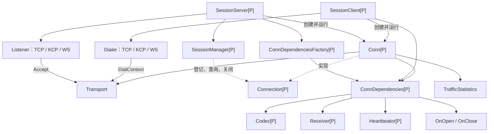

# network

`network` 提供 TCP、KCP、WebSocket 的统一连接管理。业务通过泛型消息类型 `P`、编解码器和接收器接入，不需要自己维护底层读写循环。

导入路径：`github.com/peng-qing/go_tools/common/network`。要求 Go 1.24.1 或更高版本。

## 导航

- [结构关系与职责](#结构关系与职责)
- [业务需要提供什么](#业务需要提供什么)
- [连接生命周期与并发约定](#连接生命周期与并发约定)
- [完整使用示例](#完整使用示例)
- [共享依赖与独立业务会话](#共享依赖与独立业务会话)
- [选择传输协议](#选择传输协议)
- [配置与发送压力](#配置与发送压力)
- [心跳](#心跳)
- [连接管理与关闭](#连接管理与关闭)
- [流量统计](#流量统计)
- [错误处理与测试](#错误处理与测试)

## 结构关系与职责

Go 中使用结构体和接口组织这些关系，没有继承层级。



| 类型 | 职责 | 实现位置 |
| --- | --- | --- |
| `Transport` | 统一字节读写、关闭和地址查询 | [接口](net_interface.go)、[TCP](tcp_impl.go)、[KCP](kcp_impl.go)、[WS](ws_impl.go) |
| `Listener` / `Dialer` | 接收或创建 Transport | 同上 |
| `Codec[P]` | 消息与字节帧之间的转换、帧边界和长度校验 | 业务实现，接口位于 [net_interface.go](net_interface.go) |
| `Receiver[P]` | 接收解码后的业务消息 | 业务实现 |
| `Heartbeator[P]` | 创建和识别应用层 Ping/Pong | 业务按需实现 |
| `ConnDependencies[P]` | Codec、Receiver、心跳器及可选回调的集合 | [net_interface.go](net_interface.go) |
| `ConnDependenciesFactory[P]` | 为每条服务端连接返回依赖 | 业务实现 |
| `Connection[P]` / `Conn[P]` | 消息队列、读写循环、心跳、关闭和统计 | [conn_impl.go](conn_impl.go) |
| `SessionManager[P]` / `SessionManagerImpl[P]` | 连接登记、查询、容量限制和集合关闭 | [session_manager.go](session_manager.go) |
| `SessionServer[P]` | Accept、调用工厂、登记和运行连接 | [session_server.go](session_server.go) |
| `SessionClient[P]` | 一次拨号及其连接生命周期 | [session_client.go](session_client.go) |
| `TrafficStatistics` / `TrafficSnapshot` | 累计计数与只读快照 | [traffic.go](traffic.go) |

设计边界：

- Transport 负责物理 I/O；Conn 负责消息级运行；Server/Client 负责创建和管理 Conn。
- `newConn` 是包内构造函数。业务通常通过 Server/Client 获取 `Connection[P]`。
- Server、Client 使用具体结构体；底层传输、业务处理和连接管理通过接口替换。
- 本模块不规定消息命令号、序列化格式、登录流程、业务 Actor 或任务队列。
- 不提供自动重连、业务 ACK、发送队列排空或投递成功保证；需要这些能力时由上层实现。
- 当前目录没有内置 LTV Codec 或 `network/ltv` 子包。

## 业务需要提供什么

| 内容 | 是否必须 | 约定 |
| --- | --- | --- |
| 消息类型 `P` | 必须 | 可用结构体、指针或已有协议类型 |
| `Codec[P]` | 必须 | 编码一个完整帧；解码一个完整帧；自行限制帧大小 |
| `Receiver[P]` | 按需 | 未设置时，非心跳消息被丢弃 |
| `Heartbeator[P]` | 按需 | 业务实现并注入后由 Conn 托管心跳流程；不注入时，需要的心跳由业务自行维护 |
| `OnOpen` | 按需 | 在读取消息前执行初始化，可发送初始消息 |
| `OnClose` | 按需 | 所有循环退出、底层关闭完成后释放业务资源 |
| `ConnDependenciesFactory[P]` | Server 必须 | 当前签名带 Transport；每次接收后返回依赖，不能为 nil |
| `ConnDependencies[P]` | Client 必须 | 单次连接直接使用，不需要 Factory |
| Listener / Dialer、配置 | 必须 | 可使用本包实现，也可实现对应接口 |

Codec 的当前签名：

```go
type Codec[P any] interface {
    Encode(packet P) ([]byte, error)
    Decode(reader io.Reader) (packet P, n int, err error)
}
```

`Decode` 可以阻塞，通常使用 `io.ReadFull` 读取帧头和帧体。成功时 `n` 应为本帧实际消耗的完整编码字节数，包含帧头，且不能为负数。它用于流量统计；失败时返回的字节数不计入成功流量。不要通过重新 Encode 解码后的消息来估算长度。

Codec 应能承受 Encode 与 Decode 并发调用，以及多个发送方并发 Encode；共享 Codec 还需支持跨连接并发。不要在共享 Codec 中保存当前连接的半包状态；流状态由传入的 reader 承载。Encode 返回的数据会进入异步发送队列，不能在后续调用中复用、覆盖该字节切片。

## 连接生命周期与并发约定

服务端链路：

```text
Accept → Factory → newConn → Manager.Add → goroutine: Conn.Run
                                             ↓
                     Run 结束（含 OnClose）→ Manager.Remove
```

单条连接的运行顺序：

1. 启动一个写循环，让 OnOpen 可以发送初始消息。
2. 同步执行 OnOpen；返回错误则关闭连接。
3. 尚未关闭时，启动一个读循环，并按配置启动心跳循环。
4. 读循环：Decode → 累计读取统计 → 刷新活跃时间 → 识别心跳或调用 Receiver。
5. 写循环：从队列取编码数据 → Write → 完整成功后累计写入统计。
6. 发生终止时取消连接 context、关闭 Transport；等待循环退出后执行 OnClose。

重要约定：

- Server/Client 已负责调用 Run，业务拿到连接后不要再调用 Run。
- 同一连接的 OnMessage 顺序执行，没有额外业务派发 goroutine。阻塞回调会延迟读包及心跳处理。
- 耗时业务自行交给业务队列；回调的阻塞操作应响应传入的 context。
- OnOpen 执行时读循环尚未启动，不能同步等待该连接收到登录响应等消息。
- OnOpen 可能拿到已取消的 context，应检查取消状态并及时退出。
- OnClose 在 Run 的结束路径调用。没有运行过、仅被拒绝或回收的连接不会执行这些回调。
- 可以在回调中请求 Close，但不能等待自身的 Client.Wait 或 Server.Serve 结束，否则会形成自等待。
- Transport 仅保证一个读方和一个写方的使用模式；不要从业务回调或 Factory 并行直接读写底层 Transport。
- `Connection.Err()` 返回首个终止原因。`Close()` 返回底层关闭错误，两者用途不同。

## 完整使用示例

以下程序在本机启动 TCP Server 和 Client，发送一个 JSON 消息并回显，然后关闭并等待资源退出。业务消息和心跳共用同一个长度头协议。将完整代码保存为 `main.go`，在能够导入本模块的 Go module 中运行 `go run main.go`。

```go
package main

import (
	"context"
	"encoding/binary"
	"encoding/json"
	"errors"
	"fmt"
	"io"
	"log"
	"net"
	"time"

	"github.com/peng-qing/go_tools/common/network"
)

const maxPayloadSize = 64 * 1024

type Packet struct {
	Kind string `json:"kind"`
	Seq  uint64 `json:"seq,omitempty"`
	Text string `json:"text,omitempty"`
}

// 帧格式：4 字节大端 JSON 长度 + JSON 内容。
type Codec struct{}

func (Codec) Encode(packet Packet) ([]byte, error) {
	payload, err := json.Marshal(packet)
	if err != nil {
		return nil, err
	}
	if len(payload) > maxPayloadSize {
		return nil, errors.New("packet too large")
	}
	frame := make([]byte, 4+len(payload))
	binary.BigEndian.PutUint32(frame[:4], uint32(len(payload)))
	copy(frame[4:], payload)
	return frame, nil
}

func (Codec) Decode(reader io.Reader) (Packet, int, error) {
	var packet Packet
	var header [4]byte
	n, err := io.ReadFull(reader, header[:])
	if err != nil {
		return packet, n, err
	}
	size := binary.BigEndian.Uint32(header[:])
	if size == 0 || size > maxPayloadSize {
		return packet, n, fmt.Errorf("invalid payload length: %d", size)
	}
	payload := make([]byte, int(size))
	read, err := io.ReadFull(reader, payload)
	n += read
	if err != nil {
		return packet, n, err
	}
	err = json.Unmarshal(payload, &packet)
	return packet, n, err
}

type Heartbeat struct{}

func (Heartbeat) Ping(seq uint64) Packet { return Packet{Kind: "ping", Seq: seq} }
func (Heartbeat) Pong(seq uint64) Packet { return Packet{Kind: "pong", Seq: seq} }
func (Heartbeat) Inspect(packet Packet) (network.HeartbeatKind, uint64, bool) {
	switch packet.Kind {
	case "ping":
		return network.HeartbeatKind_Ping, packet.Seq, true
	case "pong":
		return network.HeartbeatKind_Pong, packet.Seq, true
	default:
		return network.HeartbeatKind_Invalid, 0, false
	}
}

type Receiver func(context.Context, network.Connection[Packet], Packet)

func (fn Receiver) OnMessage(ctx context.Context, conn network.Connection[Packet], packet Packet) {
	fn(ctx, conn, packet)
}

func run() error {
	tcpConf := network.TCPConfig{NoDelay: true, WriteTimeout: 2 * time.Second}
	connConf := network.ConnConfig{
		SendQueueSize: 256, ReadBufferSize: 4096,
		HeartbeatInterval: time.Second, HeartbeatTimeout: 3 * time.Second,
	}
	listener, err := network.NewTCPListener("127.0.0.1:0", tcpConf)
	if err != nil {
		return err
	}
	// 工厂每次返回相同依赖：Codec、Heartbeat 和无状态 Receiver 均可共享。
	deps := network.ConnDependencies[Packet]{
		Codec: Codec{}, Heartbeator: Heartbeat{},
		Receiver: Receiver(func(ctx context.Context, conn network.Connection[Packet], packet Packet) {
			if err := conn.Send(ctx, packet); err != nil {
				_ = conn.Close()
			}
		}),
	}
	factory := func(network.Transport) (network.ConnDependencies[Packet], error) {
		return deps, nil
	}
	server, err := network.NewSessionServer(listener, factory, connConf)
	if err != nil {
		_ = listener.Close() // 构造失败，调用方仍拥有 Listener。
		return err
	}
	serveDone := make(chan error, 1)
	go func() { serveDone <- server.Serve() }()
	defer func() {
		_ = server.Close()
		if err := <-serveDone; err != nil && !errors.Is(err, net.ErrClosed) {
			log.Printf("serve: %v", err)
		}
	}()

	replies := make(chan Packet, 1)
	client, err := network.NewSessionClient(
		network.NewTCPDialer(tcpConf),
		network.ConnDependencies[Packet]{
			Codec: Codec{}, Heartbeator: Heartbeat{},
			Receiver: Receiver(func(ctx context.Context, _ network.Connection[Packet], packet Packet) {
				select {
				case replies <- packet:
				case <-ctx.Done():
				}
			}),
		},
		connConf,
	)
	if err != nil {
		return err
	}
	defer func() {
		_ = client.Close()
		_ = client.Wait()
	}()

	dialCtx, cancelDial := context.WithTimeout(context.Background(), 3*time.Second)
	conn, err := client.DialContext(dialCtx, server.Addr().String())
	cancelDial() // 只结束拨号 context，不影响已建立连接。
	if err != nil {
		return err
	}

	ctx, cancel := context.WithTimeout(context.Background(), 3*time.Second)
	defer cancel()
	if err := conn.Send(ctx, Packet{Kind: "data", Text: "hello"}); err != nil {
		return err
	}
	select {
	case packet := <-replies:
		fmt.Printf("reply=%s\n", packet.Text)
	case <-ctx.Done():
		return ctx.Err()
	}

	_ = client.Close()
	if err := client.Wait(); err != nil && !errors.Is(err, net.ErrClosed) {
		return err
	}
	fmt.Printf("traffic=%+v\n", conn.Statistics())
	return nil
}

func main() {
	if err := run(); err != nil {
		log.Fatal(err)
	}
}

```

示例使用 `127.0.0.1:0` 自动分配监听端口。部署时可改成具体地址。正式服务可在主 goroutine 中阻塞调用 Serve，由接收退出信号的 goroutine 调用 Close；也可像示例一样保存 Serve 的返回结果。

## 共享依赖与独立业务会话

Factory 当前签名为：

```go
type ConnDependenciesFactory[P any] func(Transport) (ConnDependencies[P], error)
```

它替代 Server 原来的共享 deps 参数。共享依赖时直接返回同一份 ConnDependencies；结构体按值返回不会复制接口引用的底层对象。

每连接独立状态时，在 Factory 内创建业务会话，并把 Receiver、OnOpen、OnClose 绑定到同一个对象。Codec 和 Heartbeator 仍可共享。示意代码如下，`newBusinessSession` 由业务实现：

```go
factory := func(transport network.Transport) (network.ConnDependencies[Packet], error) {
    session := newBusinessSession(transport.RemoteAddr())
    return network.ConnDependencies[Packet]{
        Codec:       Codec{},
        Heartbeator: Heartbeat{},
        Receiver:    session,
        OnOpen:      session.OnOpen,
        OnClose:     session.OnClose,
    }, nil
}
```

Factory 的运行边界：

- 在 acceptLoop 中同步调用，应及时返回；当前没有用于强制中断工厂的 context。
- Transport 可用于查看连接地址，不应由工厂接管、关闭或开始读写。
- 返回错误、空 Codec 或发生 panic 时，当前 Transport 被关闭，Server 记录错误并继续接收。
- Factory 成功后仍可能因容量限制或关闭而无法登记，不能假定一定会执行 OnOpen/OnClose。
- 工厂中只构造轻量业务对象；需要配套释放的资源在 OnOpen 中初始化，OnClose 负责释放已初始化部分。
- 共享 Receiver 可以是无状态路由器；独立 Receiver 适合保存每连接业务状态。后者若还被业务 goroutine 使用，仍需自行协调并发。

## 选择传输协议

| 协议 | Listener 构造 | Dialer 构造 |
| --- | --- | --- |
| TCP | `NewTCPListener(address, TCPConfig)` | `NewTCPDialer(TCPConfig)` |
| KCP | `NewKCPListenerImpl(address, KCPConfig)` | `NewKCPDialerImpl(KCPConfig)` |
| WebSocket | `NewWsListenerImpl(WsListenerConfig)` | `NewWsDialerImpl(WsDialerConfig)` |

替换 Listener 和 Dialer 后，上层 Codec、Receiver、Server/Client 的用法保持一致。两端必须使用兼容的协议与配置。

### TCP

- `NoDelay` 设置 TCP_NODELAY。
- KeepalivePeriod 是内核保活，不能替代应用层心跳。
- 当前 TCP 实现不直接提供 TLS 配置。

### KCP

- 通过 KCPConfig 配置 MTU、收发窗口、调度间隔、FEC、加密和 UDP 缓冲区。
- `IntervalMs` 是 KCP 调度间隔，不是应用层 HeartbeatInterval。
- 使用 FEC 时两端配置应一致；一般同时配置正数 DataShards/ParityShards，不启用时均设为零。
- 加密使用 `KCPEncryptionNone` 或 `KCPEncryptionAES`；AES 密钥必须是底层支持的长度。配置后不要并发修改密钥切片。
- 当前 KCP DialContext 不使用传入的 context。Client 会在拨号返回后回收已取消的迟到连接，但不能保证及时中断底层拨号。
- 服务端 Session 与 Listener 共享 UDP socket，因此 Listener 关闭会影响尚未关闭的 Session。

### WebSocket

- 只接收二进制消息，写入一次对应一个二进制 WS 消息。
- 读取侧隐藏 WS 消息边界，向 Codec 暴露连续字节流，因此仍需要应用协议的帧边界。
- `Path` 默认 `/`；Listener 使用 HTTP ServeMux。
- `MaxPendingConnections` 默认 1024，限制正在 Upgrade 及等待 Accept 的连接，容量满时在升级前返回 HTTP 503。
- 该限制与 SessionManager 的已登记连接数量限制不同。
- 监听端配置 TLSConfig 时必须提供证书或证书获取回调。
- 拨号地址支持 `ws://`、`wss://` 或省略协议。省略协议时，有 TLSConfig 或 RequireTLS 则默认 wss；显式 ws 只有在 RequireTLS 为 true 时才被拒绝。
- 未设置 Proxy 时使用 `http.ProxyFromEnvironment`。需强制直连时可提供始终返回 `nil, nil` 的 Proxy 函数。
- CheckOrigin、Subprotocols、Header 按业务握手要求配置。不要把浏览器 Origin 校验当作业务鉴权。
- MaxMessageSize 是底层 WS 消息读取限制；协商压缩时不能将它等同于解压后的业务帧限制，业务 Codec 仍需校验长度。
- HandshakeTimeout 默认 10 秒；Listener 的 ReadHeaderTimeout 默认 10 秒、IdleTimeout 默认 60 秒。

## 配置与发送压力

完整字段见 [config.go](config.go)。

| ConnConfig 字段 | 默认行为 | 用途 |
| --- | --- | --- |
| SendQueueSize | <= 0 时为 256 | 编码后数据的队列条目数，不是字节容量 |
| ReadBufferSize | <= 0 时为 4096 | bufio.Reader 缓冲大小，不是最大消息大小 |
| HeartbeatInterval | <= 0 时不主动探测 | 有 Heartbeator 时仍会响应收到的 Ping |
| HeartbeatTimeout | 主动心跳开启且 <= 0 时为三倍间隔 | 没有成功解码完整消息的超时时长 |

TCP/KCP/WS 配置中的 ReadTimeout、WriteTimeout 作用于各自的 I/O 调用，与 Conn 的 bufio 缓冲、队列大小和心跳超时不同。未设置读超时且未启用主动心跳时，读取可以长期阻塞，Close 用于解除阻塞。

`Send(ctx, packet)`：
- 在调用方同步编码，再等待队列空位。
- ctx 可以终止等待入队，但不能中断没有 context 参数的 Encode。
- 成功只表示入队，不代表已经写出，更不代表对端收到。
- 入队后 ctx 到期不会撤回消息。

`TrySend(packet)`：
- 同样同步编码，但不等待队列空位。
- 队列满返回 `ErrSendQueueFull`；丢弃、重试或关闭连接由上层决定。
- 若是必须送达的业务消息，应设计业务确认与重试，而不是仅依赖 Send 返回 nil。

## 心跳

应用层心跳可以选择由 Conn 托管，也可以完全由业务维护：

| 方式 | 业务职责 | Conn 职责 |
| --- | --- | --- |
| 提供 Heartbeator | 实现 Ping/Pong 的构造与识别，通过 ConnDependencies 注入，并配置心跳间隔和超时 | 识别并消费心跳、自动回复 Pong；按配置发送 Ping、检查超时并关闭连接 |
| 不提供 Heartbeator | 如果需要心跳，自行实现消息识别、发送调度、回复、活跃状态、超时判断及资源清理 | 不识别或自动回复应用层心跳，也不启动心跳循环；解码后的消息交给 Receiver，未设置 Receiver 则丢弃 |

托管时，Heartbeator 的协议实现仍由业务提供，应及时返回并支持并发调用；调度与连接关闭由 Conn 负责，业务无需再重复启动同一套心跳任务。

仅提供 Heartbeator 且 HeartbeatInterval <= 0 时，Conn 只识别心跳并响应 Ping，不主动发送 Ping，也不执行心跳超时检查。未提供 Heartbeator 时，仅设置 HeartbeatInterval/HeartbeatTimeout 不会启用托管心跳。

业务自管时，可通过 Connection.Send/TrySend 发送心跳，在 Receiver 中处理收到的心跳，并在业务判断超时后调用 Connection.Close。自行创建的定时任务应随连接 context 取消而退出，或在 OnClose 中清理；不需要心跳的业务也可以不启用这些逻辑。

以下为 Conn 托管模式的行为。心跳通过 Codec 编解码，与业务消息共用发送队列。

- 收到 Ping 后使用其 seq 创建 Pong；收到 Pong 后消费消息，不派发给 Receiver。
- 主动 Ping 的 seq 每周期递增，但当前不维护待确认 Ping 表，也不计算 RTT。
- 任意成功解码的完整消息都会更新活跃时间，不要求每个 Ping 都收到对应 Pong。
- 正在接收但尚未完成的半包不会刷新活跃时间。
- 主动 Ping 入队最多等待一个心跳周期，因队列等待超时而失败时跳过本次，下一轮继续。
- Pong 使用连接 context 等待入队；发送压力可能暂时阻塞读循环。
- 超时按周期检查，调度、编码及入队等待会增加检测延迟；不是精确到时刻的定时断开。
- WebSocket 控制帧、TCP Keepalive、KCP ACK 不属于这里的应用层心跳。

## 连接管理与关闭

默认 SessionServer 使用容量为 5000 的 SessionManager。自定义容量可以注入：

```go
manager := network.NewSessionManager[Packet](10000)
server, err := network.NewSessionServer(
    listener, factory, connConf,
    network.WithSessionManager[Packet](manager),
)
```

`NewSessionManager[P](0)` 或负数表示不额外限制。管理器应为空、未关闭，且由一个 Server 独占使用。

| 方法 | 行为 |
| --- | --- |
| Add | 登记；拒绝重复 ID、超容量和关闭后登记；失败不代替调用方关闭连接 |
| Remove | 仅注销，不关闭连接 |
| Get | 获取连接，但不能保证返回后连接仍然存活 |
| Range | 遍历快照，回调期间不持锁，返回 false 停止 |
| Len | 当前登记数，包含正在执行退出回调、尚未注销的连接 |
| Close | 停止登记并关闭已有连接，不等待 Run 或业务回调，也不清空连接表 |

自定义 SessionManager 应支持并发调用，并用同一同步边界协调 Add 和 Close，保证成功登记的连接不会被关闭快照漏掉。容量不足返回 `ErrSessionLimitReached`，关闭后返回 `net.ErrClosed`，Server 会据此分别拒绝当前连接或停止接收。

Server：
- Serve 不带 context，阻塞运行；同一实例不能重复启动。
- Close 先停止登记并关闭已登记 Conn，再关闭 Listener。这样不会提前关闭 KCP 的共享 UDP socket。
- Close 不等待业务回调，Serve 返回前会等待所有已运行连接及其回调退出。
- Accept 失败会触发清理并返回错误；正常 Close 导致的退出返回 nil。资源关闭错误从 Close 返回。
- 关闭期间收到但未登记的 Transport，由接收流程回收。

Client：
- 每个实例只允许调用一次 DialContext，包括拨号失败的情况。
- DialContext 成功返回连接，并在后台启动 Run；不保证 OnOpen 已完成或业务已就绪。
- 拨号 ctx 只控制拨号。连接建成后由连接错误、心跳超时或 Close 终止。
- Close 取消正在进行的拨号，或关闭已发布连接；Wait 等待失败结果或连接及 OnClose 完成。
- 尚未 Dial 或 Close 就调用 Wait，会返回错误。
- 重连由上层按业务策略创建新的 SessionClient，再次拨号并恢复登录状态。
- 三状态枚举用于启动与关闭控制；Client 的 Running 表示已使用拨号机会，不是在线状态，应通过 Wait/OnClose 判断结束。

## 流量统计

`conn.Statistics()` 返回 TrafficSnapshot：

| 字段 | 当前统计口径 |
| --- | --- |
| ReadMessages | 成功解码的完整消息数，包括应用层 Ping/Pong |
| ReadBytes | 上述消息的编码字节总数，来自 Decode 返回的 n，应包含帧头 |
| WriteMessages | Write 无错误且完整写入的消息数，包括应用层 Ping/Pong |
| WriteBytes | 上述完整写入消息的编码字节总数 |

统计只有读取成功和写入成功两个埋点，心跳不单独再次累加。截断帧、失败解码、部分写入、错误写入和仅入队尚未写出的消息不计入成功流量。

统计不是底层 Read/Write 调用次数，也不是网卡流量，不包含 TCP/KCP/WS 帧头、重传或控制帧开销。KCP 的成功写入可能只表示交给底层缓冲。

每个字段使用 atomic.Uint64；快照各字段独立读取，不保证同一时刻的一致性。没有 Reset，计算速率时由上层用两次快照做差。连接对象仍被持有时，关闭后也可以查询最终累计值。

遍历 Server 当前连接求和，只代表当前登记连接的累计值，不包含已移除连接的历史。需要服务级历史统计时，应由上层在 OnClose 汇总最终快照并设计好并发采样方式。

## 错误处理与测试

- 错误判断优先使用 `errors.Is`，例如 ErrSendQueueFull、ErrHeartbeatTimeout、net.ErrClosed。
- 读写失败、短写、OnOpen 返回错误、OnMessage panic 会终止连接。
- 读、写、心跳循环的 panic 会转为关闭原因；OnClose panic 记录日志，不改变首个终止原因。
- Factory 返回错误或 panic 只拒绝当前连接，Server 继续接收。
- 调用方同步执行的 Encode panic 不由循环 recover 拦截；业务 Codec 应返回 error 表示可预期失败。
- 当前实现直接向标准错误输出关闭及部分异常信息，不提供可配置日志接口。

在仓库根目录运行：

```bash
go test ./common/network
go test -race ./common/network -count=20 -timeout=120s
go vet ./common/network
```

测试覆盖连接生命周期、Factory 共享与独立依赖、并发登记和关闭、迟到连接回收、心跳序号与统计、半包/粘包、短写及 TCP/KCP/WS 环回收发。网络测试使用本机临时端口，不依赖外部服务。
